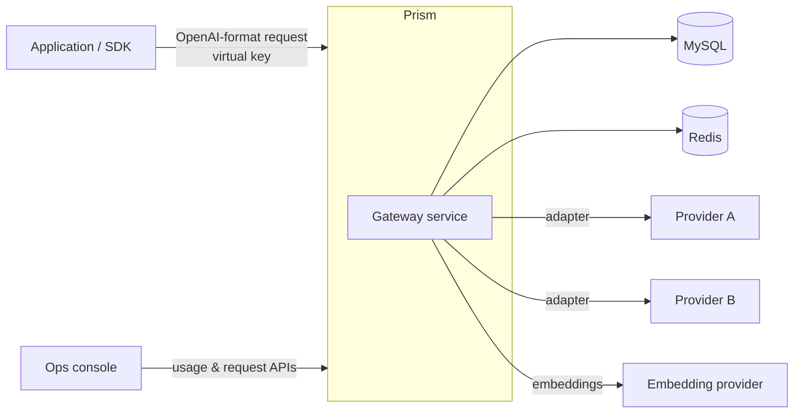
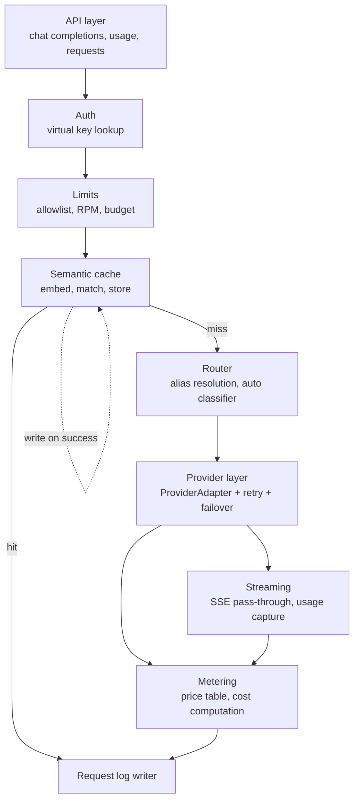

# Prism: Architecture

This document describes how Prism is structured and why. It is derived from [ProblemStatement.md](ProblemStatement.md). The build sequence lives in the implementation plan, not here.

---

## 1. System Context

Prism sits between application code and model providers. Applications send OpenAI-format requests to Prism with a virtual key. Prism authenticates the key, applies limits, serves from cache when it can, routes to a provider, and meters the result. Provider credentials stay inside Prism and never reach callers.



Three properties shape the design:

- **Callers never see providers.** They use a model alias such as `fast` or `smart`, or `auto`.
- **The data plane is OpenAI-compatible.** Existing SDKs work by changing only the base URL.
- **Machine judgment runs in the request path.** Difficulty classification and semantic matching happen before a provider is called, so they must be fast and bounded.

---

## 2. Container View

| Container | Responsibility | Tech |
| --- | --- | --- |
| Gateway service | Data plane (`/v1/chat/completions`), control APIs (usage, requests, keys), auth, limits, cache, routing, streaming, metering | Spring Boot 3, WebFlux |
| MySQL | Durable state: virtual keys, usage records, request logs, cache entries, schema history | MySQL, Flyway |
| Redis | Hot-path state: RPM counters, budget reservations, cache index for lookup | Redis, Lua scripts |
| Ops console | Usage by key, recent requests, cache hit rate | React, TypeScript, Tailwind |
| Provider adapters | Translate the internal request model to each provider's API and back | In-process, behind `ProviderAdapter` |

The gateway is one deployable service. Components are separated by package, not by process, because the request path is latency-sensitive and the gateway has no independently scaling parts yet.

---

## 3. Component View



Responsibilities and boundaries:

- **API layer** owns HTTP concerns: request parsing, the OpenAI response shape, headers, and error envelopes. It contains no business logic.
- **Auth** resolves a virtual key to a tenant record. Nothing after auth runs without a resolved key.
- **Limits** owns admission. It is the only component that decides whether a request may proceed to cache, routing, or a provider.
- **Semantic cache** owns lookup and write. It never calls a provider.
- **Router** owns the choice of model. It returns a primary model and an ordered fallback chain, and it does not call providers.
- **Provider layer** owns upstream calls, timeouts, retries, and failover. Nothing above it knows which provider served a request except through the response metadata.
- **Metering** owns cost. It is the only component that reads the price table.
- **Request log** is written once per request, including rejections, so every outcome is recorded.

---

## 4. Request Lifecycle

A single request passes through these stages in order. Each stage can end the request.

1. **Parse and authenticate.** Read the `Authorization` header and resolve the virtual key. Reject with `invalid_key` if it is unknown or disabled.
2. **Admit.** Check the model against the key's allowlist (`model_not_allowed`). Atomically check and increment the RPM window (`rate_limited`). Atomically reserve the estimated maximum cost against the monthly budget (`budget_exhausted`).
3. **Cache lookup.** If the request is cacheable, embed the normalized prompt and search only this key's entries. On a hit above the threshold, release the reservation, return the cached response with `x-prism-cache: hit`, and log the request.
4. **Route.** Resolve the alias or model name to a primary model and fallback chain. For `auto`, run the difficulty classifier first and map its result to `fast` or `smart`.
5. **Call provider.** Invoke the adapter for the primary model with connect, first-byte, and total timeouts. On a transient error, retry with exponential backoff and jitter, up to a bounded count. When retries are exhausted, move to the next model in the chain.
6. **Respond.** For non-streaming requests, return the full body. For streaming requests, forward chunks as they arrive, then send `data: [DONE]`.
7. **Finalize.** Compute actual cost from the reported usage. Release the difference between the reservation and the actual cost. Write the request record. On success, write the cache entry if the request is cacheable.

The response headers are set before the body is sent, so the header contract holds for streamed responses too:

| Header | Set when |
| --- | --- |
| `x-prism-provider` | A provider call was made. Records the provider that served the response. |
| `x-prism-cache` | Always. `hit` or `miss`. |
| `x-prism-fallback` | Always. `true` if the response came from a fallback model. |
| `x-prism-cost-usd` | Always. Cost of the request. `0` on a cache hit. |

For streaming, `x-prism-cost-usd` is known only after the stream ends. Clients that need the cost in the header must use non-streaming requests. Streaming requests always report cost in the usage API.

---

## 5. Concurrency Model

Prism's correctness under load depends on three rules.

**Admission is atomic.** The RPM check and increment run in one Redis Lua script. A read-then-write sequence in application code would let concurrent requests all pass a check that only one of them should have passed.

**Budget uses reservations, not post-hoc charges.** Charging after a call would let many concurrent requests each see remaining budget and together exceed it. Instead, the gateway reserves the estimated maximum before the call. After the call, the gateway releases the difference between the reservation and the actual cost. The reservation and release both run as atomic Redis operations, and every reservation is balanced by a release or a charge.

**Accounting reconciles with the log.** Each request writes exactly one usage record and one request log entry. Totals in the usage API are computed from these records, so they can be checked against the log.

Redis is the source of truth for in-flight reservations. MySQL is the source of truth for settled usage. A background reconciliation job compares the two and corrects drift caused by crashes between reserve and release. The reconciliation job is a known gap in the first version (see §10).

---

## 6. Streaming Architecture

The streaming path is a reactive pipeline with no intermediate buffer:

```
provider chunk → adapter (normalize to OpenAI delta) → gateway (forward) → client
```

- The gateway uses WebFlux and a non-blocking HTTP client for provider calls.
- Each chunk is forwarded as soon as the adapter emits it. The gateway does not collect chunks into a response.
- Usage is captured from the final chunk when the provider reports it. If the provider does not report usage, the gateway estimates token counts and marks the usage record `usage_estimated`.
- Client disconnects cancel the upstream subscription. The request record is still written, with status `client_closed`.
- **Failover is allowed only before the first byte is sent to the client.** After that point, a provider error ends the stream with an error event followed by `[DONE]`, and the request is logged as failed.

Streaming and caching interact as follows: streaming requests are not written to the cache, and a streaming request is not served from the cache. This keeps the streaming path simple and avoids replaying a cached answer as a fake stream. The rule is documented for callers.

---

## 7. Routing Architecture

Routing has two layers.

**Alias resolution (deterministic).** Each alias maps to a primary model and an ordered fallback chain. The mapping comes from `gateway_config.sample.json`. A caller that names a model directly is routed to that model if the key's allowlist permits it.

**Difficulty classification (for `auto`).** The classifier takes the prompt and returns `fast` or `smart`. It runs before any provider call and must complete within a fixed budget. If it cannot complete in that budget, the request routes to `smart`, the safer default, and the decision is logged as `classifier_timeout`.

The classifier is evaluated against a labeled set that includes two traps:

- **Short but hard:** a brief prompt that needs a strong model.
- **Long but trivial:** a long prompt that a cheap model handles correctly.

A length-only baseline is evaluated on the same set. The classifier must beat it. Accuracy is reported per case, so a regression on one class of prompt is visible.

---

## 8. Failover and Retry Architecture

Failures are classified before they are handled:

| Error class | Examples | Handling |
| --- | --- | --- |
| Transient | timeout, connection reset, HTTP 429, HTTP 5xx | Retry with backoff, then fail over |
| Permanent for this model | HTTP 404 for model, model disabled | Fail over immediately, no retry |
| Permanent for the request | HTTP 400 from the provider | Return the error to the caller, no retry, no fallback |

Retries use exponential backoff with jitter and a fixed upper bound on attempts. The total time spent on retries and fallbacks is bounded by the request's overall timeout, so a request never runs longer than that bound.

Failover records:

- `x-prism-fallback: true` on the response.
- The primary and the serving model in the request log.
- The reason for the failover.

The failover path is tested by taking one mock provider down. The request must succeed on the fallback, and the log must show the failover.

---

## 9. Metering and Cost Architecture

Cost is computed in one place from two inputs:

```
cost = (prompt_tokens × input_price) + (completion_tokens × output_price)
```

- Prices come from `model_pricing.json`, loaded at startup and keyed by provider model ID.
- Token counts come from the provider's reported usage. Estimates are used only when the provider reports none, and they are flagged.
- Cost is stored in integer micro-dollars in MySQL and in Redis, so sums are exact. It is converted to USD for display and headers.
- A cache hit costs `0` and records the tokens that were saved as a separate field, so the cache's value can be reported.

The usage API computes totals per key and per time window from these records. The ops console reads from the same API.

---

## 10. Data Model

| Store | Entity | Key fields | Notes |
| --- | --- | --- | --- |
| MySQL | `virtual_keys` | id, secret hash, team, model allowlist, RPM limit, monthly budget, status | Secret stored as a hash. Seed keys are loaded from `seed_keys.json`. |
| MySQL | `usage_records` | id, key id, model, provider, prompt tokens, completion tokens, cost (micro-USD), cache result, fallback flag, latency, status, created at | One row per request. The source of truth for totals. |
| MySQL | `request_logs` | id, key id, request summary, status, error code, timestamps, primary and serving model | One row per request, including rejections. |
| MySQL | `cache_entries` | id, key id, embedding, response, model, created at, expires at | Searched only within one key id. |
| Redis | `rpm:{keyId}` | sliding-window counter | Atomic check and increment via Lua. |
| Redis | `budget:{keyId}:{YYYY-MM}` | committed spend, active reservations | Atomic reserve and release via Lua. |

Every table that stores tenant data includes the key id, and every query on it filters by that id.

---

## 11. Cache Architecture

**Matching.** The gateway normalizes the request (model, system prompt, message history, and the final user message) into one text, computes its embedding, and compares it to embeddings stored under the same key id. A match above the threshold is a hit.

**Isolation.** The key filter runs before any similarity comparison. Entries from other keys are never loaded into the comparison set, so a leak cannot happen through the similarity score. This is the property the isolation test checks.

**Eligibility.** A request is cacheable when it is non-streaming and has temperature `0`. Other requests bypass the cache entirely, and the bypass is logged.

**Lifecycle.** Entries have a TTL. Each key has an entry cap, and the oldest entries are evicted when the cap is reached.

**Scaling limit.** The first version compares the embedding against all of a key's entries, which is linear in entry count. This is acceptable at the scale of the demo and the load test. A vector index is a later change behind the same cache interface (see §12).

---

## 12. Error Model

Every rejection returns the OpenAI error envelope with a Prism error code. Each code has its own HTTP status and is documented in the README.

| Error code | HTTP status | Meaning |
| --- | --- | --- |
| `invalid_key` | 401 | Key is missing, unknown, or disabled |
| `model_not_allowed` | 403 | The key's allowlist does not include the model |
| `rate_limited` | 429 | RPM limit reached. Includes `Retry-After`. |
| `budget_exhausted` | 402 | Monthly budget cannot cover the estimated cost |
| `provider_unavailable` | 503 | All models in the fallback chain failed |
| `upstream_timeout` | 504 | A timeout was hit and no fallback could serve the request |

Each error is recorded in the request log with its code.

---

## 13. Security

- **Virtual keys** are random, high-entropy strings. Only a hash is stored. The plain key is shown once, at creation.
- **Provider credentials** are read from configuration and never returned in responses, logs, or errors.
- **Tenant isolation** is enforced in the data model (every row carries the key id) and in the cache (the key filter runs first).
- **Console access** is limited in the first version (see §14).
- **Request logs** store a summary of the request, not the full prompt, by default. Full capture is opt-in per key and documented.

---

## 14. Observability

- **Metrics** (Micrometer): request count, latency percentiles, cost per key and provider, cache hit rate, fallback count, and rejection count by code.
- **Request logs** are the audit trail. Every request has one entry, so any traffic issue can be traced from the key, model, provider, and status.
- **Health** endpoints report the status of MySQL, Redis, and each configured provider.

---

## 15. Deployment and Configuration

- **Configuration** comes from three files loaded at startup: `model_pricing.json`, `seed_keys.json`, and `gateway_config.sample.json`. Changing a model's price or an alias does not require a code change.
- **Secrets** (provider API keys, database credentials) come from environment variables.
- **Local setup** runs the gateway, MySQL, and Redis together and uses the mock providers, so the demo works without external keys.
- **Schema** is managed by Flyway migrations in `db/migration/`.

---

## 16. Known Limitations

These are accepted for the first version. Each one is also listed in the README.

- **Reconciliation** between Redis reservations and MySQL settlements runs as a periodic job and can drift for a short time after a crash.
- **Cache search** is linear in the number of entries per key.
- **Streaming responses** are not cached and cannot fail over after the first byte.
- **The classifier** is a heuristic tuned on a small labeled set. It is not validated on production traffic.
- **Console** has no per-user authentication in the first version.
- **Single-instance** deployment is assumed. Redis Lua scripts keep admission correct across instances, but no instance-level leader election is implemented.

---

## 17. Key Design Decisions

| Decision | Alternatives considered | Reason |
| --- | --- | --- |
| Reactive WebFlux for the gateway | Blocking servlet stack | Streaming pass-through without holding threads per open stream |
| Redis Lua for admission and reservations | Application-level locks, read-then-write | Atomic under concurrency without a lock service |
| Reserve-then-release for budgets | Charge after the call | Prevents concurrent requests from overspending |
| Key-scoped cache lookup before similarity | Global index with a key filter after | Tenant isolation holds by construction, not by filtering results |
| Failover only before first byte | Switching providers mid-stream | A client cannot receive two providers' output in one response |
| Costs in integer micro-USD | Floating-point dollars | Exact sums for accounting and reconciliation |
| Single deployable service | Separate routing and metering services | The request path is latency-sensitive, and the parts are not yet independently scaled |
